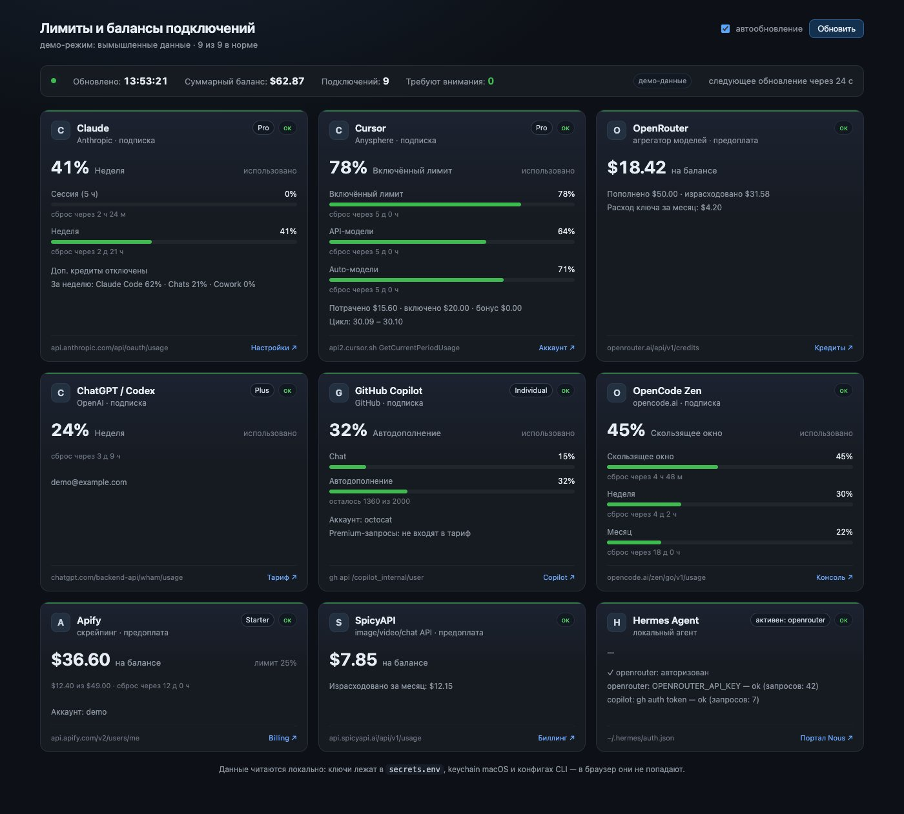
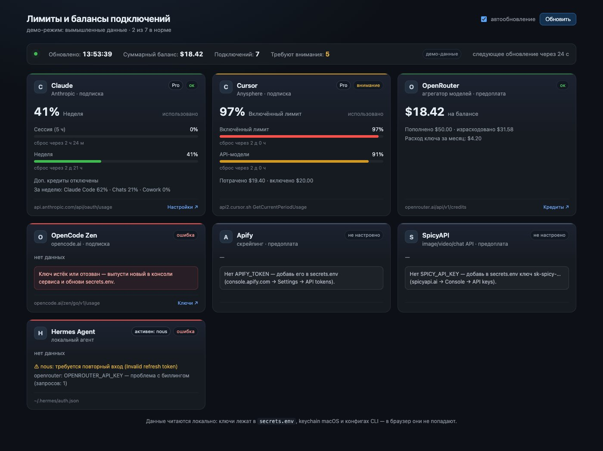

# usage-dashboard

A small local web page that shows **limits and balances across your API subscriptions in
real time** — one screen instead of eight billing dashboards.

It runs as a single Python file on your machine, reads credentials from where your tools
already keep them, and never sends them anywhere except the provider's own API. The browser
only receives numbers and error texts.

The UI is in Russian; the code and this README are in English.



*`python3 server.py --demo` — all numbers and account names above are fictional.*



*`--demo problems`: an expired key, a nearly exhausted limit, two services without tokens and a
broken agent login. Each card explains what to fix; the rest of the page keeps working.*

## Providers

| Provider | Endpoint used | What you see |
|---|---|---|
| **Claude** (Anthropic) | `api.anthropic.com/api/oauth/usage` | 5-hour session, weekly window, per-product breakdown, extra credits |
| **Cursor** | `GetCurrentPeriodUsage`, `full_stripe_profile` | included/API/Auto usage %, billing cycle, spend |
| **OpenRouter** | `api/v1/credits`, `api/v1/key` | USD balance, total spent, key quota, monthly usage |
| **ChatGPT / Codex** | `chatgpt.com/backend-api/wham/usage` | plan, rate-limit windows, reset time |
| **GitHub Copilot** | `gh api /copilot_internal/user` | chat, completions, premium requests |
| **OpenCode Zen** | `opencode.ai/zen/go/v1/usage` | rolling / weekly / monthly windows |
| **Apify** | `api.apify.com/v2/users/me` | monthly usage vs plan limit, remaining USD |
| **SpicyAPI** | `api.spicyapi.ai/api/v1/usage` | USD balance |
| **Hermes Agent** | `~/.hermes/auth.json` | auth state of the agent's provider pool |
| anything else | `custom` block in `config.json` | balance / percent / line values from any JSON endpoint |

Claude, Cursor, Codex and Copilot need **no keys** — the dashboard reads the tokens of the
apps you already signed in to (macOS keychain, `state.vscdb`, `~/.codex/auth.json`, `gh`).
Apify, SpicyAPI and OpenCode need a token in `secrets.env`.

## Run

```bash
git clone https://github.com/<you>/usage-dashboard.git
cd usage-dashboard
cp secrets.env.example secrets.env   # optional, only for key-based providers
chmod 600 secrets.env
python3 server.py                    # http://127.0.0.1:8787
```

No dependencies — Python 3.9+ standard library only.

```
python3 server.py --port 9000        # another port
python3 server.py --host 0.0.0.0     # expose to LAN (opt-in)
python3 server.py --demo             # fictional data, no credentials read
python3 server.py --demo problems    # fictional data with failing services
```

## Keys

| Variable | Where to get it |
|---|---|
| `APIFY_TOKEN` | console.apify.com → Settings → Integrations → Personal API token |
| `SPICY_API_KEY` | spicyapi.ai/console/keys (looks like `sk-spicy-…`) |
| `OPENROUTER_API_KEY` | optional: falls back to `~/.hermes/.env` |
| `OPENCODE_API_KEY` | optional: falls back to `~/.local/share/opencode/auth.json` |

Missing key → the card stays on the page with an explanation of what to add. Nothing crashes.

## Adding your own service

Drop an entry into `custom` in `config.json`:

```json
"custom": [
  {
    "id": "myapi",
    "name": "My API",
    "subtitle": "my gateway · prepaid",
    "url": "https://api.example.com/v1/usage",
    "token_env": "MYAPI_TOKEN",
    "auth_header": "Bearer {token}",
    "balance_path": "data.balance",
    "currency": "USD",
    "windows": [
      { "label": "Month", "percent_path": "data.used_percent", "reset_path": "data.resets_at" }
    ],
    "lines": [{ "label": "Spent", "path": "data.spent" }],
    "links": [{ "label": "Console", "url": "https://example.com/billing" }]
  }
]
```

Paths are dot-separated lookups into the JSON response. For a first-class provider, add a
`fetch_<id>()` function in `providers.py` and register it in `BUILTIN` and `ORDER`.

## How it works

```
server.py        stdlib HTTP server: /, /api/usage, /api/health
providers.py     one adapter per service → one normalized card
config.json      enabled providers + custom endpoints
secrets.env      tokens (600, gitignored)
web/index.html   the whole page: CSS + JS, no build step
```

- All providers are fetched in parallel, each with its own timeout.
- Responses are cached for 25 s (`cache_seconds`); `/api/usage?force=1` bypasses the cache.
- One failing service never breaks the page — its card shows the reason and the fix.
- 80 % of a limit turns the bar amber, 95 % or a request failure turns it red.

## Security

- `secrets.env` is `chmod 600` and in `.gitignore`.
- The server listens on `127.0.0.1` by default.
- Tokens never leave the server process: the JSON API returns numbers and error strings only.
- No telemetry, no external assets, no CDN.

## Limitations

- Anthropic has no public balance API for subscriptions — only rate-limit windows are shown,
  the same ones `claude /usage` displays.
- Cursor's `GetCurrentPeriodUsage` is undocumented and may change after an app update.
- Nous Portal (Hermes) has no public credits endpoint; the card reports auth state instead.
- Per-seat or enterprise plans may expose fields this dashboard does not parse yet.

## License

MIT — see [LICENSE](LICENSE).
